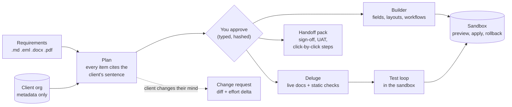
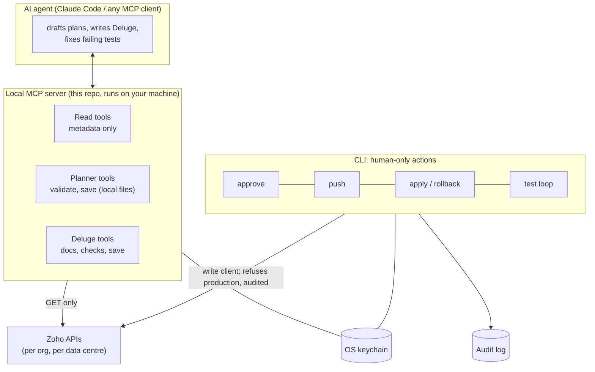

# Zoho Implementer Copilot

[](https://github.com/lixmed/zoho-implementer-copilot/actions/workflows/ci.yml)


**A local AI copilot for Zoho partners. It turns a client's requirements into a working Zoho CRM setup, and a human approves every step.**

Clients send requirements as emails, Word docs and meeting notes. An implementer turns them into fields, layouts, workflows, Deluge functions, connections and developer tickets, usually by hand and usually with gaps. This tool does that work *with* the implementer: an AI agent plans and writes the code, and a local server enforces the rules that keep client orgs safe.

```powershell
uv tool install git+https://github.com/lixmed/zoho-implementer-copilot
copilot demo
```
`copilot demo` runs the whole workflow in about 5 seconds against a built-in fake Zoho, so **no Zoho account is needed**.

---

## What it does



1. **Plan with traceability.** Requirements are split into addressable sentences, and every plan item must cite the ones it comes from. The server *computes* coverage, and a plan that silently drops a requirement can't be saved. → [planner](docs/planner.md)
2. **Validate against the real org.** Field and module names are checked against live metadata, so a workflow on a made-up field is an error, not a surprise in production.
3. **Write Deluge with live docs.** The agent looks up the exact syntax in Zoho's official docs for each app, ranked locally so queries never leave the machine. Static checks block hard-coded secrets, missing connections and unknown fields. → [deluge](docs/deluge.md)
4. **Apply as a change set.** It previews every API call and its credits, applies after a typed confirmation, stops at the first failure, and rolls back softly (hide or deactivate, never delete data). → [builder](docs/builder.md)
5. **Test in the sandbox.** Automation logic is written as a testable core function. Fake test records are created, checked and always cleaned up. The agent fixes failures, and you confirm each re-push. → [test loop](docs/test-loop.md)
6. **Hand off the rest.** Anything Zoho has no API for (connections, validation rules, blueprints…) becomes a ready-to-place package: code with a placement header, scopes with reasons, a sign-off doc and a UAT script.

## Safety model: rules in the server, not in the prompt

| Risk | What stops it |
|---|---|
| The AI reads customer data | Planning requests **no record permissions at all**: metadata only. Users are masked with an allowlist. Contact details in requirements are masked. |
| The AI changes the org on its own | There are **no write, approve, push or apply tools over MCP.** Every write is a CLI command where you type a confirmation. |
| Approved plan edited afterwards | Approvals store a SHA-256 hash, and an edited plan counts as unapproved. |
| Writing to production | Writes are refused outside developer, sandbox or test orgs. The environment is detected from Zoho's own response, and a mismatch revokes the token. |
| Losing data on undo | Soft rollback by default. Hard delete needs a second typed confirmation that names the data loss. |
| Stolen tokens | Refresh tokens live only in the OS keychain. PKCE plus a state check, and the Zoho data-centre host is checked against an allowlist before any secret is sent. |
| No paper trail | Append-only SQLite audit log (UPDATE and DELETE blocked by triggers) with before/after for every write. |

Full write-up: [docs/security-model.md](docs/security-model.md)

## Architecture



## Engineering decisions
Each one is an ADR with the options considered:
[agent client](docs/decisions/0001-agent-client.md) ·
[OAuth flow](docs/decisions/0002-oauth-flow.md) ·
[tooling & secrets](docs/decisions/0003-tooling-and-secrets.md) ·
[planner](docs/decisions/0004-planner-design.md) ·
[Deluge generation](docs/decisions/0005-deluge-generation.md) ·
[builder](docs/decisions/0006-builder.md) ·
[test loop](docs/decisions/0007-test-loop.md)

The API research that shaped all of it: [docs/zoho-api-coverage.md](docs/zoho-api-coverage.md).

## Verified against a real Zoho org, and what's pending

| Area | Status |
|---|---|
| OAuth with PKCE, localhost redirect, all data centres | ✅ real org. Found and fixed a Zoho quirk: PKCE verifiers containing `.` or `~` intermittently fail. |
| Free/trial org detection (reports itself as "production") | ✅ real org. Accepted as `test` only if unpaid and you type its id. |
| All 11 metadata read tools | ✅ real org |
| Deluge function create via API | ⏳ the free tier has no custom functions; waiting for a paid sandbox |
| Builder writes, test loop execution | ⏳ tested against a stateful fake built from Zoho's doc samples; inferred details listed in the docs |

## Quick start (real org)
```powershell
uv tool install git+https://github.com/lixmed/zoho-implementer-copilot
copilot doctor
copilot client set --dc us
copilot connect --name "My Dev Org" --env developer
```
Then add it to Claude Code:
```powershell
claude mcp add zoho-copilot -- copilot serve
```
Step-by-step guide: [docs/setup.md](docs/setup.md). Testing for free: [docs/testing.md](docs/testing.md).

## Status
| Phase | | |
|---|---|---|
| 0 | Zoho API coverage research | ✅ |
| 1 | OAuth, keychain, read-only MCP tools | ✅ |
| 2 | Planner: traceability, change requests, sign-off and UAT | ✅ |
| 3 | Deluge generation: live docs, static checks, gated push | ✅ |
| 4 | Builder: change sets, soft rollback | ✅ |
| 5 | Deluge test loop | ✅ |
| 8 | One-command install, offline demo, docs | ✅ |
| 6 | Evaluation suite against gold plans | next |
| 7 | Multi-org, production safeguards, credit budgets | planned |

**Tests:** 130+ tests including a full end-to-end "story" (connect → plan → approve → Deluge → test loop → apply → rollback → change request → revoke). They run on Windows and Linux in CI.

**Stack:** Python 3.12 · MCP Python SDK 2.x · httpx · pydantic · keyring · SQLite · pytest + respx · ruff · uv · GitHub Actions.

## License
MIT
